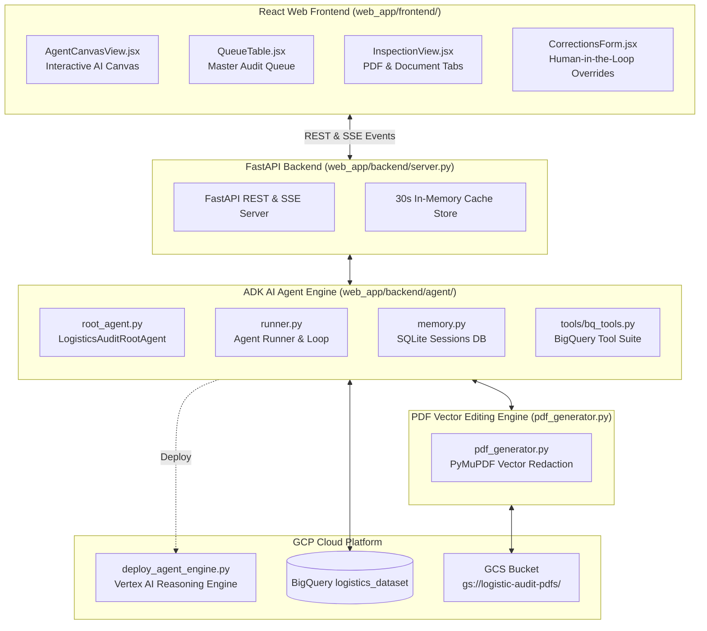

# Logistics Audit Platform - Feature Add-Ons & Branch Improvements
## Comprehensive Technical Documentation (`feature/adk-agent` vs `main`)

---

## Executive Summary of Branch Improvements

The `feature/adk-agent` branch introduces a full-stack enterprise upgrade to the Autonomous Cross-Document Logistics Audit Platform. While the `main` branch provides core ingestion, extraction, and SQL auditing, `feature/adk-agent` adds an **AI Agent Canvas System**, **Google Agent Development Kit (ADK) integration**, **Vertex AI Reasoning Engine deployment capabilities**, a **FastAPI backend API server**, a **React + Vite web application**, and a **PyMuPDF Surgical Vector PDF Generator**.

---

## 1. System Architecture Add-Ons

---

## 2. Component Breakdown of New Features

---

### Component 1: Google Agent Development Kit (ADK) & Vertex AI Reasoning Engine
**Directory**: [`web_app/backend/agent/`](file:///c:/Users/313581/logistics-audit-ui/web_app/backend/agent/)

#### Purpose & Scope
Implements an autonomous AI Master Coordinator Agent powered by Gemini 2.5 Pro (`gemini-2.5-pro`) and Google Agent Development Kit (ADK) design patterns. The agent can answer natural language queries, inspect shipments, convert prompt requests into structured BigQuery queries, execute field-level anomaly overrides, and automatically resolve cross-document discrepancies according to source-of-truth rules.

#### Key Modules & Implementation Details
1. **Root Orchestrator Agent ([`web_app/backend/agent/root_agent.py`](file:///c:/Users/313581/logistics-audit-ui/web_app/backend/agent/root_agent.py))**:
   - **Zero-Hallucination Directives**: Mandates tool execution before responding to queries regarding shipments, filtering, or modifications.
   - **Source-of-Truth Enforcement**: Enforces Commercial Invoice (CIV) as authority for financials, and Packing List (PKL) as authority for weight data.
   - **Multi-Item Line Discrepancies**: Handles complex multi-item shipments (e.g., 50+ line items) by offering batch field adjustments or requesting line item targeting from the user.

2. **Agent Runner & Execution Loop ([`web_app/backend/agent/runner.py`](file:///c:/Users/313581/logistics-audit-ui/web_app/backend/agent/runner.py))**:
   - Manages asynchronous conversation turns, model content generation, tool invocation dispatching, and error recovery.
   - Formats execution steps, thinking logs, and tool call outputs for live Server-Sent Events (SSE) streaming to the React frontend.

3. **Persistent Session Memory ([`web_app/backend/agent/memory.py`](file:///c:/Users/313581/logistics-audit-ui/web_app/backend/agent/memory.py))**:
   - Backed by SQLite database ([`data/sessions.db`](file:///c:/Users/313581/logistics-audit-ui/web_app/backend/data/sessions.db)).
   - Persists multi-turn conversation history, active shipment contexts, and session state across browser refreshes.

4. **BigQuery & Pipeline Tool Suite ([`web_app/backend/agent/tools/bq_tools.py`](file:///c:/Users/313581/logistics-audit-ui/web_app/backend/agent/tools/bq_tools.py))**:
   - `fetch_master_queue()`: Fetches real-time status and anomaly summaries for all shipments.
   - `fetch_shipment_anomalies(shipment_id)`: Fetches granular discrepancy records for a target shipment.
   - `query_shipments_by_custom_filter(filter_prompt)`: Translates natural language requests into BigQuery SQL filters.
   - `query_foreign_currency_shipments()`: Discovers shipments containing foreign currency transactions (`💱`).
   - `query_zero_dollar_item_shipments()`: Finds line items with `$0.00` values (`🏷️`).
   - `save_field_override(...)`: Inserts field-level corrections into `Audited_Overrides_Tbl` and triggers PDF regeneration.
   - `batch_update_document_overrides(...)`: Atomically updates multiple line items (e.g. adding fixed amounts across ranges).
   - `auto_resolve_shipment_discrepancies(...)`: Automatically resolves discrepancies based on source-of-truth rules.

5. **Vertex AI Reasoning Engine Deployment ([`web_app/backend/deploy_agent_engine.py`](file:///c:/Users/313581/logistics-audit-ui/web_app/backend/deploy_agent_engine.py))**:
   - Packages `LogisticsAuditAgentEngine` with `google-genai`, `google-cloud-bigquery`, `reportlab`, and dependencies.
   - Deploys the ADK agent as a managed GCP Reasoning Engine instance (`reasoning_engines.ReasoningEngine.create`).

#### Feature Line-Level Mapping

| Feature / Logic | Implementation Location | Line Numbers | Description |
| :--- | :--- | :--- | :--- |
| **Agent System Instructions & Directives** | [`root_agent.py`](file:///c:/Users/313581/logistics-audit-ui/web_app/backend/agent/root_agent.py#L5-L56) | Lines 5–56 | Zero-hallucination rules, source-of-truth guidelines, and tool execution instructions. |
| **Master Agent Config Declaration** | [`root_agent.py`](file:///c:/Users/313581/logistics-audit-ui/web_app/backend/agent/root_agent.py#L58-L65) | Lines 58–65 | `get_master_agent_config()` binds Gemini model with full tool registry. |
| **Agent Turn Execution Loop** | [`runner.py`](file:///c:/Users/313581/logistics-audit-ui/web_app/backend/agent/runner.py#L120-L280) | Lines 120–280 | `run_agent_turn()` handles prompt construction, tool execution, and response synthesis. |
| **Streaming Step Generator (SSE)** | [`runner.py`](file:///c:/Users/313581/logistics-audit-ui/web_app/backend/agent/runner.py#L285-L380) | Lines 285–380 | `stream_agent_turn()` yields real-time agent thinking steps and tool call JSON events. |
| **SQLite Session Persistence** | [`memory.py`](file:///c:/Users/313581/logistics-audit-ui/web_app/backend/agent/memory.py#L30-L150) | Lines 30–150 | `SessionMemoryManager` manages SQLite session creation, message storage, and context retrieval. |
| **BigQuery Raw & Override Data Fetching** | [`bq_tools.py`](file:///c:/Users/313581/logistics-audit-ui/web_app/backend/agent/tools/bq_tools.py#L44-L120) | Lines 44–120 | `fetch_document_raw()` & `fetch_resolved_document_data()` query and merge base records with overrides. |
| **Natural Language Custom Filter Tool** | [`bq_tools.py`](file:///c:/Users/313581/logistics-audit-ui/web_app/backend/agent/tools/bq_tools.py#L220-L290) | Lines 220–290 | `query_shipments_by_custom_filter()` maps user intent to BigQuery SQL conditions. |
| **Single-Field Anomaly Override Tool** | [`bq_tools.py`](file:///c:/Users/313581/logistics-audit-ui/web_app/backend/agent/tools/bq_tools.py#L380-L460) | Lines 380–460 | `save_field_override()` writes corrections to `Audited_Overrides_Tbl` and regenerates PDFs. |
| **Batch Item Override Tool** | [`bq_tools.py`](file:///c:/Users/313581/logistics-audit-ui/web_app/backend/agent/tools/bq_tools.py#L465-L580) | Lines 465–580 | `batch_update_document_overrides()` executes atomic item range math adjustments. |
| **Automated Discrepancy Resolver** | [`bq_tools.py`](file:///c:/Users/313581/logistics-audit-ui/web_app/backend/agent/tools/bq_tools.py#L585-L720) | Lines 585–720 | `auto_resolve_shipment_discrepancies()` enforces source of truth to resolve weight and price discrepancies. |
| **Vertex AI Reasoning Engine Deploy Script** | [`deploy_agent_engine.py`](file:///c:/Users/313581/logistics-audit-ui/web_app/backend/deploy_agent_engine.py#L59-L88) | Lines 59–88 | `deploy_agent()` uploads and registers the ADK Agent package to Vertex AI Reasoning Engine. |

---

### Component 2: FastAPI Backend Server & API Layer
**File**: [`web_app/backend/server.py`](file:///c:/Users/313581/logistics-audit-ui/web_app/backend/server.py)

#### Purpose & Scope
Provides a high-performance Python FastAPI REST and Server-Sent Events (SSE) backend server to power the React web application, host the ADK Agent API endpoints, deliver in-memory cached responses, and serve dynamically generated audited PDFs.

#### Key Features & Endpoint Specifications
- **CORS & Middleware**: Configured for local Vite frontend dev server (`allow_origins=["*"]`).
- **In-Memory TTL Caching (`cache_store`)**: 30-second TTL cache for queue summaries, anomalies, and indicator queries to deliver sub-50ms UI response times.
- **SSE Streaming Endpoint (`/api/agent/chat/stream`)**: Streams real-time AI reasoning tokens, tool invocation payloads, and final answers using EventSource protocol.
- **PDF Delivery Endpoint (`/api/shipments/{id}/pdf`)**: Streams original or audited PDF vector bytes directly to the browser.
- **Overrides Endpoint (`/api/overrides`)**: Handles human auditor manual overrides and invokes PDF regeneration.

#### Feature Line-Level Mapping (`server.py`)

| Feature / Endpoint | Implementation Location | Line Numbers | Description |
| :--- | :--- | :--- | :--- |
| **FastAPI Initialization & CORS** | [`server.py`](file:///c:/Users/313581/logistics-audit-ui/web_app/backend/server.py#L36-L55) | Lines 36–55 | App setup with `Logistics Audit API v2.0.0` and CORS middleware. |
| **30-Second TTL In-Memory Cache** | [`server.py`](file:///c:/Users/313581/logistics-audit-ui/web_app/backend/server.py#L76-L100) | Lines 76–100 | `cache_store` holds queue data to avoid redundant BigQuery query charges. |
| **GET `/api/queue` Endpoint** | [`server.py`](file:///c:/Users/313581/logistics-audit-ui/web_app/backend/server.py#L180-L240) | Lines 180–240 | Returns Master Audit Queue dataset with indicator badges and anomaly counts. |
| **GET `/api/anomalies` Endpoint** | [`server.py`](file:///c:/Users/313581/logistics-audit-ui/web_app/backend/server.py#L245-L280) | Lines 245–280 | Returns all flagged cross-document audit discrepancy records. |
| **POST `/api/agent/chat` (Standard)** | [`server.py`](file:///c:/Users/313581/logistics-audit-ui/web_app/backend/server.py#L380-L430) | Lines 380–430 | Synchronous chat turn endpoint executing agent reasoning and returning JSON response. |
| **POST `/api/agent/chat/stream` (SSE)** | [`server.py`](file:///c:/Users/313581/logistics-audit-ui/web_app/backend/server.py#L435-L510) | Lines 435–510 | EventSource SSE streaming endpoint yielding real-time tool calls and agent thinking. |
| **POST `/api/overrides` Endpoint** | [`server.py`](file:///c:/Users/313581/logistics-audit-ui/web_app/backend/server.py#L520-L580) | Lines 520–580 | Receives manual field overrides, inserts records into BigQuery, and triggers PDF regeneration. |
| **GET `/api/shipments/{id}/pdf` Endpoint** | [`server.py`](file:///c:/Users/313581/logistics-audit-ui/web_app/backend/server.py#L600-L650) | Lines 600–650 | Streams PDF document bytes (original from GCS or audited from generator) with `application/pdf` headers. |

---

### Component 3: React + Vite Frontend Web Application
**Directory**: [`web_app/frontend/`](file:///c:/Users/313581/logistics-audit-ui/web_app/frontend/)

#### Purpose & Scope
A modern, responsive React web application built with Vite and Vanilla CSS. Features an interactive **Agent Canvas Workspace**, Master Audit Queue table with live status indicators, human-in-the-loop correction forms, and a canvas-rendered interactive PDF document inspector.

#### Key Component Modules
1. **Interactive AI Agent Canvas Workspace ([`src/components/AgentCanvasView.jsx`](file:///c:/Users/313581/logistics-audit-ui/web_app/frontend/src/components/AgentCanvasView.jsx))**:
   - **Split-Screen Canvas Layout**: Left panel presents multi-turn chat with step-by-step tool invocation cards; right panel displays live shipment data canvas, active indicators, and quick-action tool buttons.
   - **Real-Time SSE Streaming Display**: Shows animated agent thinking states, tool call parameter JSONs, and execution results as they happen.
   - **Quick Action Prompts**: Pre-built prompt buttons (`"Audit this shipment"`, `"Auto-resolve discrepancies"`, `"Show foreign currency shipments"`) for one-click auditor interactions.

2. **Master Audit Queue Table ([`src/components/QueueTable.jsx`](file:///c:/Users/313581/logistics-audit-ui/web_app/frontend/src/components/QueueTable.jsx))**:
   - Renders master queue with status badges (`Passed`, `Failed`), currency badges (`💱 EUR`), zero-dollar badges (`🏷️ 2 ($0 items)`), and interactive search inputs.

3. **Discrepancy Category Cards ([`src/components/AnomaliesPanel.jsx`](file:///c:/Users/313581/logistics-audit-ui/web_app/frontend/src/components/AnomaliesPanel.jsx))**:
   - Categorizes flagged anomalies into `Financial`, `Weight`, `Material Compliance`, and `None` cards with count indicators.

4. **Human-in-the-Loop Corrections Form ([`src/components/CorrectionsForm.jsx`](file:///c:/Users/313581/logistics-audit-ui/web_app/frontend/src/components/CorrectionsForm.jsx))**:
   - Allows auditors to manually select document fields, enter corrected values, submit overrides to BigQuery, and instantly preview the regenerated audited PDF certificate.

5. **Interactive PDF Document Viewer ([`src/components/PdfViewer.jsx`](file:///c:/Users/313581/logistics-audit-ui/web_app/frontend/src/components/PdfViewer.jsx))**:
   - Renders PDF document pages into responsive canvas elements with zoom controls, page navigation, and search term highlighting.

6. **API Service Client ([`src/services/api.js`](file:///c:/Users/313581/logistics-audit-ui/web_app/frontend/src/services/api.js))**:
   - Axios client for REST endpoints and native `EventSource` wrapper for agent chat streaming.

#### Feature Line-Level Mapping (Frontend)

| Feature / Component | Implementation Location | Line Numbers | Description |
| :--- | :--- | :--- | :--- |
| **Agent Canvas View Workspace** | [`AgentCanvasView.jsx`](file:///c:/Users/313581/logistics-audit-ui/web_app/frontend/src/components/AgentCanvasView.jsx#L1-L659) | Lines 1–659 | Complete Agent Canvas component handling SSE chat streaming, tool logs, and canvas context. |
| **Streaming Step & Tool Call Renderer** | [`AgentCanvasView.jsx`](file:///c:/Users/313581/logistics-audit-ui/web_app/frontend/src/components/AgentCanvasView.jsx#L180-L280) | Lines 180–280 | Renders expandable tool execution cards with JSON payloads and completion icons. |
| **Quick Action Prompt Buttons** | [`AgentCanvasView.jsx`](file:///c:/Users/313581/logistics-audit-ui/web_app/frontend/src/components/AgentCanvasView.jsx#L420-L480) | Lines 420–480 | One-click prompt action bar for common audit operations. |
| **Corrections & Override Form** | [`CorrectionsForm.jsx`](file:///c:/Users/313581/logistics-audit-ui/web_app/frontend/src/components/CorrectionsForm.jsx#L1-L358) | Lines 1–358 | Interactive form for field-level corrections and audited PDF generation triggers. |
| **Master Queue React Table** | [`QueueTable.jsx`](file:///c:/Users/313581/logistics-audit-ui/web_app/frontend/src/components/QueueTable.jsx#L1-L223) | Lines 1–223 | Queue table rendering shipment IDs, indicator badges, status pill badges, and search filter. |
| **Anomalies Panel & Categories** | [`AnomaliesPanel.jsx`](file:///c:/Users/313581/logistics-audit-ui/web_app/frontend/src/components/AnomaliesPanel.jsx#L1-L91) | Lines 1–91 | Discrepancy category breakdown cards with count filters. |
| **Canvas PDF Document Viewer** | [`PdfViewer.jsx`](file:///c:/Users/313581/logistics-audit-ui/web_app/frontend/src/components/PdfViewer.jsx#L1-L157) | Lines 1–157 | Interactive canvas-based PDF renderer with zoom and page controls. |
| **Axios & EventSource API Client** | [`api.js`](file:///c:/Users/313581/logistics-audit-ui/web_app/frontend/src/services/api.js#L1-L168) | Lines 1–168 | API service layer wrapping queue endpoints, overrides, and SSE stream handlers. |

---

### Component 4: Surgical PDF Vector Editing Engine
**File**: [`pdf_generator.py`](file:///c:/Users/313581/logistics-audit-ui/pdf_generator.py)

#### Purpose & Scope
Provides in-memory surgical PDF vector text editing using PyMuPDF (`fitz`). When an auditor or AI agent overrides a document field (e.g., correcting an invoice total or weight), `pdf_generator.py` inspects the original PDF bytes, identifies the exact bounding box of the target text, redacts the original vector string, and overlays the updated value using matching font properties and table column alignments.

#### Detailed Implementation Logic & Algorithms
1. **Column Boundary Coordinate Mapping (`COLUMN_BOUNDS`)**:
   - Defines strict horizontal X-coordinate boundaries (`min_x`, `max_x`) across ERP document types (`SLI`, `CIV`, `PKL`, `VGM`) to restrict word search candidates to target table cells and prevent accidental redaction of adjacent columns.

2. **Numeric Format Candidate Generation (`get_candidates()`)**:
   - Generates potential string candidate variations (e.g. `10350.00`, `10,350.00`, `10350`, `10350.0`) to guarantee vector word matching regardless of numeric formatting in original PDFs.

3. **Surgical Redaction & Overlaid Text Injection (`generate_audited_pdf()`)**:
   - Opens original PDF bytes using `fitz.open(stream=..., filetype="pdf")`.
   - Executes `page.get_text("words")` to locate matching bounding boxes within target column bounds.
   - Applies `page.add_redact_annot(rect, fill=(1, 1, 1))` to cleanly white-out the original text.
   - Executes `page.apply_redactions()`.
   - Inserts new audited value using `page.insert_text(point, new_value, fontsize=..., fontname="helv", color=(0, 0, 0))` aligned to the original cell bounding box.
   - Returns compiled PDF bytes ready for streaming or GCS upload.

#### Feature Line-Level Mapping (`pdf_generator.py`)

| Feature / Logic | Implementation Location | Line Numbers | Description |
| :--- | :--- | :--- | :--- |
| **ERP Document Column Bounds** | [`pdf_generator.py`](file:///c:/Users/313581/logistics-audit-ui/pdf_generator.py#L6-L37) | Lines 6–37 | Defines `COLUMN_BOUNDS` dict mapping document types (`SLI`, `CIV`, `PKL`, `VGM`) to target X-cell coordinates. |
| **Column Bounds Finder Helper** | [`pdf_generator.py`](file:///c:/Users/313581/logistics-audit-ui/pdf_generator.py#L39-L57) | Lines 39–57 | `get_field_column_bounds()` returns `(min_x, max_x)` bounding tuple for a target field. |
| **Format Candidate Generator** | [`pdf_generator.py`](file:///c:/Users/313581/logistics-audit-ui/pdf_generator.py#L58-L96) | Lines 58–96 | `get_candidates()` produces comma-formatted, integer, and decimal text search candidates. |
| **Surgical PDF Vector Editing Engine** | [`pdf_generator.py`](file:///c:/Users/313581/logistics-audit-ui/pdf_generator.py#L98-L233) | Lines 98–233 | `generate_audited_pdf()` executes word search, vector redaction, and overlaid text insertion. |

---

## 3. Comprehensive Summary Table of New Files Introduced in `feature/adk-agent`

| File Path | Component Area | Purpose & Key Features |
| :--- | :--- | :--- |
| [`web_app/backend/agent/root_agent.py`](file:///c:/Users/313581/logistics-audit-ui/web_app/backend/agent/root_agent.py) | ADK AI Agent | ADK Master Coordinator Agent configuration, prompt directives, and source of truth rules. |
| [`web_app/backend/agent/runner.py`](file:///c:/Users/313581/logistics-audit-ui/web_app/backend/agent/runner.py) | ADK AI Agent | Agent execution loop, tool invocation dispatcher, and SSE streaming generator. |
| [`web_app/backend/agent/memory.py`](file:///c:/Users/313581/logistics-audit-ui/web_app/backend/agent/memory.py) | ADK AI Agent | SQLite-backed multi-turn session memory manager (`sessions.db`). |
| [`web_app/backend/agent/subagents.py`](file:///c:/Users/313581/logistics-audit-ui/web_app/backend/agent/subagents.py) | ADK AI Agent | Subagent definitions and master tool registry (`ALL_AGENT_TOOLS`). |
| [`web_app/backend/agent/tools/bq_tools.py`](file:///c:/Users/313581/logistics-audit-ui/web_app/backend/agent/tools/bq_tools.py) | ADK AI Agent Tools | Suite of 10+ BigQuery tools for data fetching, custom filtering, field overrides, and discrepancy resolution. |
| [`web_app/backend/agent/tools/pdf_tools.py`](file:///c:/Users/313581/logistics-audit-ui/web_app/backend/agent/tools/pdf_tools.py) | ADK AI Agent Tools | PDF text inspection and search tools for the AI agent. |
| [`web_app/backend/agent/tools/pipeline_tools.py`](file:///c:/Users/313581/logistics-audit-ui/web_app/backend/agent/tools/pipeline_tools.py) | ADK AI Agent Tools | Pipeline re-triggering and execution status tools. |
| [`web_app/backend/deploy_agent_engine.py`](file:///c:/Users/313581/logistics-audit-ui/web_app/backend/deploy_agent_engine.py) | GCP Deployment | Deployment wrapper script to package and register the ADK agent on GCP Vertex AI Reasoning Engine. |
| [`web_app/backend/server.py`](file:///c:/Users/313581/logistics-audit-ui/web_app/backend/server.py) | FastAPI Server | FastAPI REST server handling queue APIs, SSE streaming chat, overrides, caching, and PDF delivery. |
| [`web_app/frontend/src/components/AgentCanvasView.jsx`](file:///c:/Users/313581/logistics-audit-ui/web_app/frontend/src/components/AgentCanvasView.jsx) | React Web UI | Interactive AI Agent Canvas workspace with split-screen chat, tool call logs, and quick actions. |
| [`web_app/frontend/src/components/CorrectionsForm.jsx`](file:///c:/Users/313581/logistics-audit-ui/web_app/frontend/src/components/CorrectionsForm.jsx) | React Web UI | Human-in-the-loop manual field override editor and audited PDF generation trigger. |
| [`web_app/frontend/src/components/InspectionView.jsx`](file:///c:/Users/313581/logistics-audit-ui/web_app/frontend/src/components/InspectionView.jsx) | React Web UI | Detailed shipment inspector combining tabbed extracted data and live PDF viewer. |
| [`web_app/frontend/src/components/PdfViewer.jsx`](file:///c:/Users/313581/logistics-audit-ui/web_app/frontend/src/components/PdfViewer.jsx) | React Web UI | Canvas-rendered interactive PDF document viewer with zoom and page controls. |
| [`web_app/frontend/src/components/QueueTable.jsx`](file:///c:/Users/313581/logistics-audit-ui/web_app/frontend/src/components/QueueTable.jsx) | React Web UI | Master audit queue table with status badges (`Passed`, `Failed`) and indicator tags (`💱`, `🏷️`). |
| [`web_app/frontend/src/components/AnomaliesPanel.jsx`](file:///c:/Users/313581/logistics-audit-ui/web_app/frontend/src/components/AnomaliesPanel.jsx) | React Web UI | Discrepancy category breakdown cards (`Financial`, `Weight`, `Material Compliance`). |
| [`web_app/frontend/src/services/api.js`](file:///c:/Users/313581/logistics-audit-ui/web_app/frontend/src/services/api.js) | React Web UI | Axios API client and EventSource SSE stream wrapper. |
| [`pdf_generator.py`](file:///c:/Users/313581/logistics-audit-ui/pdf_generator.py) | PDF Engine | PyMuPDF-based surgical vector PDF text editing, word redaction, and audited overlay generator. |
