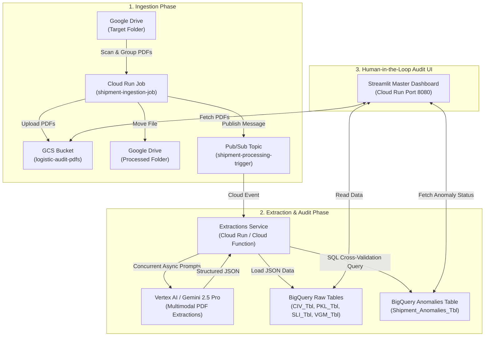

# 🚢 Logistics Document Auditing System & Master Dashboard

A comprehensive, end-to-end, AI-powered document processing and auditing platform built for logistics teams. The system automatically ingests multi-document shipment packages (Commercial Invoices, Packing Lists, Shipper's Letter of Instructions, Verified Gross Mass), extracts structured data using Google Gemini 2.5 Pro multimodal models, executes automated cross-validation reconciliation in BigQuery, and provides a Streamlit web interface for logistics document auditing and anomaly monitoring.

---

## 📐 System Architecture Overview



---

## 📂 Core Components & Repository Structure

```
logistics-audit-ui/
├── app.py                      # Main Streamlit Master Dashboard application
├── Dockerfile                  # Docker container definition for Streamlit UI (Port 8080)
├── requirements.txt            # Python dependencies for the UI application
├── ingestion/
│   ├── main.py                 # Ingestion pipeline logic (Drive to GCS transfer + Pub/Sub trigger)
│   ├── Dockerfile              # Docker container for Cloud Run Ingestion Job
│   └── requirements.txt        # Dependencies for ingestion script
└── extractions/
    ├── main.py                 # Gemini extraction engine + BigQuery SQL audit trigger
    └── requirements.txt        # Dependencies for AI extraction service
```

---

## 🔄 1. Ingestion Pipeline (`ingestion/`)

The ingestion pipeline handles the automated discovery, grouping, validation, and storage of incoming shipment documentation.

### Workflow:
1. **Google Drive Polling**:
   - Scans Google Drive folder (`1FOnW5J9k763udzfdxW9d8iPg15RQQq2f`) for unprocessed PDF files matching an 8-digit shipment ID pattern (`_\d{8}`).
2. **Document Grouping & Completeness Check**:
   - Groups files by shipment ID.
   - Enforces presence of the 3 mandatory baseline documents:
     - **CIV**: Commercial Invoice
     - **PKL**: Packing List
     - **SLI**: Shipper's Letter of Instructions
   - *(Optional document: **VGM** - Verified Gross Mass)*
3. **Storage & Archival**:
   - Clears existing GCS files under prefix `shipment_{shipment_id}/` in bucket `logistic-audit-pdfs` to support clean re-uploads.
   - Streams PDF bytes from Drive to GCS (`gs://logistic-audit-pdfs/shipment_{shipment_id}/{file_name}`).
   - Moves processed files in Google Drive to the Processed destination folder (`1rAdbu6a9M8mvxdJCSXUduSfQ9RYPuY7u`).
4. **Event Triggering**:
   - Publishes a JSON payload to Google Cloud Pub/Sub topic `shipment-processing-trigger`:
     ```json
     {
       "shipment_id": "10351463",
       "processed_at": "2026-07-28T11:00:00-05:00",
       "files": {
         "CIV_10351463_1.pdf": "gs://logistic-audit-pdfs/shipment_10351463/CIV_10351463_1.pdf",
         "PKL_10351463_1.pdf": "gs://logistic-audit-pdfs/shipment_10351463/PKL_10351463_1.pdf",
         "SLI_10351463_1.pdf": "gs://logistic-audit-pdfs/shipment_10351463/SLI_10351463_1.pdf"
       }
     }
     ```

---

## 🤖 2. Extractions & Cross-Validation Pipeline (`extractions/`)

The extraction pipeline is an event-driven service listening to Pub/Sub events, calling Gemini 2.5 Pro for multimodal structured data extraction, and running an automated cross-validation audit in BigQuery.

### 2.1 Multimodal Extractions (Gemini 2.5 Pro)
- Utilizes Vertex AI `google-genai` SDK (`gemini-2.5-pro`).
- Requests are executed asynchronously (`asyncio.gather`) across all shipment documents simultaneously using rigid JSON schemas (`temperature=0.0`).

| Document Type | Schema / Extracted Fields | Prompt Scope |
| :--- | :--- | :--- |
| **CIV** (Commercial Invoice) | `total_amount` (float), `items` (`material_number`, `hts_code`) | Total amount and itemized part numbers / HTS codes. |
| **PKL** (Packing List) | `gross_weight_lb`, `gross_weight_kg`, `net_weight_lb`, `net_weight_kg`, `pallet_count`, `loose_case_count`, `material_numbers` | Weight totals in LB and KG, pallet/case counts, material numbers. |
| **SLI** (Shipper's Letter of Instructions) | `total_value_usd`, `gross_weight_kg`, `net_weight_kg`, `items` (`value_usd`, `gross_weight_kg`, `net_weight_kg`) | Total value in USD, gross/net weights, and package line items. |
| **VGM** (Verified Gross Mass) | `gross_weight_lb`, `gross_weight_kg` | Certified gross weight in LB and KG. |

### 2.2 BigQuery Ingestion
- Structured JSON outputs are parsed and loaded into BigQuery dataset `it-ai-briggs-agentspace.logistics_dataset`:
  - `CIV_Tbl`
  - `PKL_Tbl`
  - `SLI_Tbl`
  - `VGM_Tbl`

### 2.3 Automated SQL Cross-Validation Audit Engine
Upon completing extractions, a SQL audit query evaluates cross-document discrepancies and inserts flag records into `Shipment_Anomalies_Tbl`:
1. **Financial Cross-Check**: Compares total CIV invoice amount (`SUM(total_amount)`) against SLI total USD value (`total_value_usd`).
2. **Weight Cross-Check**:
   - Compares VGM certified gross weight (`gross_weight_lb`) vs PKL gross weight (`gross_weight_lb`).
   - Compares SLI gross/net weight (KG) vs PKL gross/net weight (KG) using a **1.0 KG tolerance buffer**.
3. **Material Compliance Check**: Compares itemized material numbers in PKL against CIV material numbers to flag missing compliance numbers.

---

## 🖥️ 3. Frontend UI & Master Dashboard (`app.py`)

A Streamlit web dashboard running in Cloud Run providing a centralized control tower for logistics auditors.

### Key Features:
1. **Master Audit Queue**:
   - Real-time status tracking (`Passed`, `Failed`, `Resolved`).
   - Search by Shipment ID and status filters.
   - **Sync New Documents Now**: Programmatically triggers the Cloud Run Job via `google.cloud.run_v2.JobsClient` and polls BigQuery every 15 seconds until results appear.
2. **Shipment Inspection View**:
   - **Document Viewer**: Embedded Base64 PDF viewer inside an iframe with document switching (`CIV`, `PKL`, `SLI`, `VGM`).
   - **Identified Anomalies Panel**: Displays flagged discrepancies and status evaluation.

---

## ☁️ 4. Google Cloud Infrastructure & Deployment

### GCP Resources

| Resource Type | Resource Name | Description |
| :--- | :--- | :--- |
| **GCP Project** | `it-ai-briggs-agentspace` | Target project hosting all logistics services. |
| **GCP Region** | `us-central1` | Default deployment region. |
| **GCS Bucket** | `logistic-audit-pdfs` | PDF document storage bucket (`shipment_{id}/`). |
| **Pub/Sub Topic** | `shipment-processing-trigger` | Asynchronous trigger for extraction function. |
| **Cloud Run Job** | `shipment-ingestion-job` | Scheduled/triggered container job for Drive ingestion. |
| **Cloud Run / Function** | Extractions Service | Event-driven container processing Pub/Sub triggers. |
| **Cloud Run Service** | Master Dashboard Service | Web application running Streamlit on Port 8080. |
| **BigQuery Dataset** | `logistics_dataset` | Data warehouse storing extracted and audited tables. |

### BigQuery Tables Schema Summary

- `CIV_Tbl`: `shipment_id`, `total_amount`, `items` (ARRAY<STRUCT>), `processed_at`
- `PKL_Tbl`: `shipment_id`, `gross_weight_lb`, `gross_weight_kg`, `net_weight_lb`, `net_weight_kg`, `pallet_count`, `loose_case_count`, `material_numbers` (ARRAY<STRING>), `processed_at`
- `SLI_Tbl`: `shipment_id`, `total_value_usd`, `gross_weight_kg`, `net_weight_kg`, `items` (ARRAY<STRUCT>), `processed_at`
- `VGM_Tbl`: `shipment_id`, `gross_weight_lb`, `gross_weight_kg`, `processed_at`
- `Shipment_Anomalies_Tbl`: `shipment_id`, `processed_at`, `discrepancy_category`, `field_flagged`, `expected_value`, `actual_value`

---

## 🚀 5. Local Setup & Execution Guide

### Prerequisites
- Python 3.10+
- Google Cloud SDK (`gcloud`) authenticated with access to `it-ai-briggs-agentspace`
- Docker (for container builds)

### Running the Streamlit UI Locally
```bash
# 1. Install dependencies
pip install -r requirements.txt

# 2. Authenticate GCP Application Default Credentials
gcloud auth application-default login

# 3. Run Streamlit Dashboard
streamlit run app.py
```

### Running Ingestion Locally
```bash
cd ingestion
pip install -r requirements.txt
python main.py
```

### Building Docker Containers
```bash
# Build UI Container
docker build -t gcr.io/it-ai-briggs-agentspace/logistics-audit-ui:latest .

# Build Ingestion Container
docker build -t gcr.io/it-ai-briggs-agentspace/shipment-ingestion-job:latest ./ingestion
```
