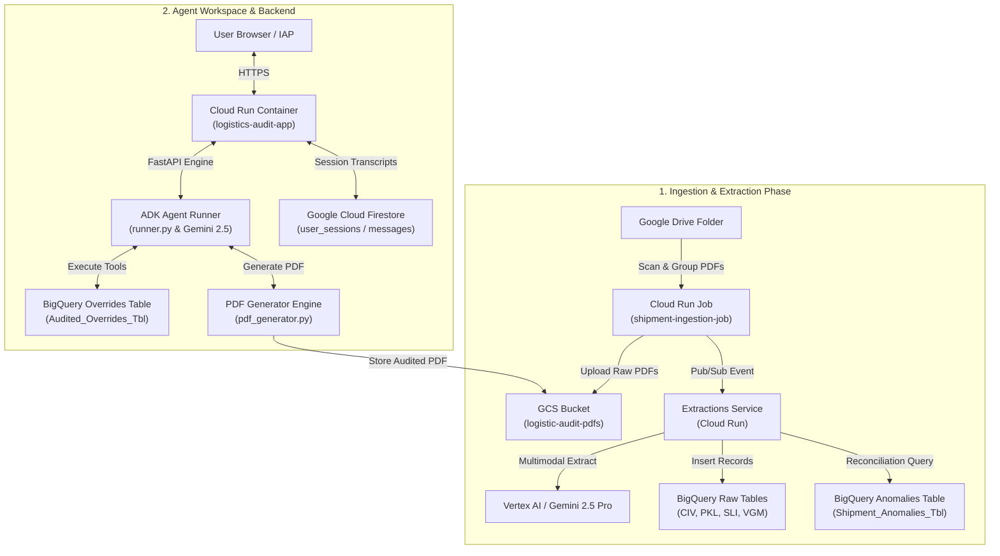

# 🚢 Logistics Audit Platform & ADK Master AI Agent

An end-to-end, AI-powered logistics document processing, cross-validation, and automated anomaly resolution platform built on **Google Agent Development Kit (ADK)**, **Gemini 2.5 Pro**, **FastAPI**, **React**, and **BigQuery**.

The system ingests multi-document shipment packages (Commercial Invoices, Packing Lists, Shipper's Letter of Instructions, Verified Gross Mass), executes automated reconciliation in BigQuery, and provides a dual-mode interactive workspace featuring a **Master Grid Dashboard** and an **Agent Canvas Workspace** with real-time reasoning and stamp-certified audited PDF generation.

---

## 🌟 Key Features on `feature/adk-agent` Branch

* 🤖 **Google ADK Master Agent Orchestrator**:
  * Step-by-step reasoning trajectory streams for full explainability.
  * Automated tool execution loop (`inspect_shipment_audit`, `auto_resolve_shipment_discrepancies`, `batch_update_document_overrides`, `reset_shipment_overrides`, `flag_shipment_audit_resolved`, `reopen_shipment_audit`).
  * Natural language item adjustment translator (`parse_and_execute_item_instruction`) powered by Gemini 2.5 Pro to convert prompts like *"Add the differences of all three fields to the first item on SLI"* into exact field override deltas.

* 📄 **Stamp-Certified Audited PDF Generator**:
  * Real-time PDF modification engine (`pdf_generator.py`) using ReportLab and PyPDF.
  * Burns dynamic auditor approval stamps, discrepancy summaries, and line-item delta tables directly onto the original PDF document and stores it in Cloud Storage bucket `logistic-audit-pdfs`.

* ⚡ **Modern React SPA + FastAPI Single Container**:
  * **Agent Canvas View**: Dual-pane workspace with live agent chat stream, tool execution trajectory breakdown, PDF document viewer, anomalies panel, and override controls.
  * **Grid Dashboard View**: Master audit queue table with status filters (`Passed`, `Failed`, `Resolved`) and one-click Google Drive sync trigger.
  * **FastAPI Backend**: Unified API endpoints for queue management, shipment detail, agent execution, override resets, and static SPA serving (`web_app/backend/server.py`).

* 💾 **Google Cloud Firestore Persistent Memory**:
  * Writes user sessions and message logs to Firestore collections (`user_sessions` and `messages` subcollection) in `it-ai-briggs-agentspace`.
  * SQLite fallback for offline/local development.

---

## 📐 System Architecture Overview



---

## 📂 Repository Structure

```
logistics-audit-ui/
├── Dockerfile                        # Multi-stage Dockerfile for FastAPI + React Cloud Run deployment
├── requirements.txt                  # Root Python dependencies
├── pdf_generator.py                  # Stamp-certified audited PDF generator engine
├── ingestion/                        # Cloud Run Job for Google Drive file discovery & ingestion
│   ├── main.py
│   └── Dockerfile
├── extractions/                      # Event-driven Gemini extraction service & SQL audit engine
│   ├── main.py
│   └── requirements.txt
└── web_app/
    ├── backend/                      # Python FastAPI Backend
    │   ├── server.py                 # Main FastAPI application & SPA static route server
    │   ├── requirements.txt          # Backend container dependencies
    │   ├── Dockerfile                # Production Cloud Run container definition
    │   ├── deploy_agent_engine.py    # Vertex AI Agent Engine deployment wrapper
    │   └── agent/
    │       ├── runner.py             # ADK Agent reasoning loop & tool orchestrator
    │       ├── memory.py             # Firestore persistent memory module
    │       ├── prompts.py            # Master coordinator system instructions
    │       └── tools/
    │           ├── bq_tools.py       # BigQuery audit & override tools
    │           └── shipment_tools.py # Shipment status & resolution tools
    └── frontend/                     # React 18 + Vite SPA Frontend
        ├── package.json
        ├── vite.config.js
        └── src/
            ├── App.jsx               # Main SPA router & view switcher
            ├── services/api.js       # Centralized REST API client
            └── components/
                ├── AgentCanvasView.jsx  # Dual-pane ADK Agent workspace
                ├── QueueTable.jsx       # Master Audit Queue table
                ├── InspectionView.jsx   # Detailed shipment inspector
                ├── PdfViewer.jsx        # PDF document viewer
                ├── AnomaliesPanel.jsx   # Flagged discrepancies panel
                └── Header.jsx           # App navigation header & sync trigger
```

---

## ☁️ Cloud Infrastructure & GCP Configuration

| Resource | Value / Name | Description |
| :--- | :--- | :--- |
| **GCP Project** | `it-ai-briggs-agentspace` | Target project hosting all services. |
| **GCP Region** | `us-central1` | Deployment region. |
| **Cloud Run Service** | `logistics-audit-app` | Unified FastAPI + React application endpoint. |
| **Cloud Run Job** | `shipment-ingestion-job` | Triggered job scanning Google Drive for PDFs. |
| **GCS Bucket** | `logistic-audit-pdfs` | Document storage for raw and stamp-certified audited PDFs. |
| **BigQuery Dataset** | `logistics_dataset` | Data warehouse containing extraction, anomaly, and override tables. |
| **Firestore Database** | `(default)` / `logistics-adk-db` | NoSQL document store for user sessions and chat transcripts. |
| **Service Account** | `logistics-audit@it-ai-briggs-agentspace.iam.gserviceaccount.com` | IAM principal with BigQuery, Datastore, Storage, Vertex AI, and Cloud Run execution roles. |

---

## 🚀 Local Setup & Deployment Guide

### Prerequisites
- Python 3.10+
- Node.js 18+ & npm
- Google Cloud SDK (`gcloud`) authenticated with access to `it-ai-briggs-agentspace`

### 1. Running the FastAPI Backend & React Frontend Locally

```bash
# 1. Install frontend dependencies and build assets
cd web_app/frontend
npm install
npm run build
xcopy /E /I /Y dist ..\backend\dist   # Windows (or cp -r dist ../backend/ on Linux/macOS)

# 2. Install backend dependencies
cd ../backend
pip install -r requirements.txt

# 3. Authenticate Google Cloud Application Default Credentials
gcloud auth application-default login

# 4. Start FastAPI server
python -m uvicorn server:app --host 0.0.0.0 --port 8080 --reload
```
Open **[http://localhost:8080](http://localhost:8080)** in your browser.

---

### 2. Deploying to Google Cloud Run

To build the container image and deploy directly to Cloud Run:

```bash
cd web_app/backend

gcloud run deploy logistics-audit-app \
  --source=. \
  --region=us-central1 \
  --project=it-ai-briggs-agentspace \
  --service-account=logistics-audit@it-ai-briggs-agentspace.iam.gserviceaccount.com \
  --clear-base-image \
  --set-env-vars="PROJECT_ID=it-ai-briggs-agentspace,DATASET_ID=logistics_dataset,BUCKET_NAME=logistic-audit-pdfs,USE_FIRESTORE=true" \
  --allow-unauthenticated
```

Live Service URL: **[https://logistics-audit-app-585562805447.us-central1.run.app](https://logistics-audit-app-585562805447.us-central1.run.app)**

---

## 🚧 Status & Outstanding Technical Roadmap

> [!NOTE]
> This branch represents the current deployed version on Cloud Run. The technical roadmap below outlines upcoming enhancements required for production completion.

Refer to [`technical_handoff_and_future_roadmap.md`](file:///c:/Users/313581/.gemini/antigravity/brain/bee39098-fc99-468b-88c2-bf75abb7b039/technical_handoff_and_future_roadmap.md) for full implementation specifications.

1. **Identity-Aware Proxy (IAP) User Authentication**:
   * Bind each user's Identity-Aware Proxy header (`X-Goog-Authenticated-User-Email`) to Firestore `logistics-adk-db`.
   * Restore user chat sessions automatically across browser hard-refreshes based on authenticated email identity.

2. **Vertex AI Agent Engine Integration**:
   * Deploy the ADK Master Agent orchestrator as a managed serverless agent using [`web_app/backend/deploy_agent_engine.py`](file:///c:/Users/313581/logistics-audit-ui/web_app/backend/deploy_agent_engine.py).

3. **UI/UX Enhancements**:
   * **Sync Drive Spinner**: Add polling on `/api/sync/status` to show a spinning progress state while `shipment-ingestion-job` executes on Cloud Run.
   * **Historical Conversations Sidebar**: Add a collapsible left sidebar in `AgentCanvasView` allowing users to browse, toggle, create, or delete past audit conversation threads.
