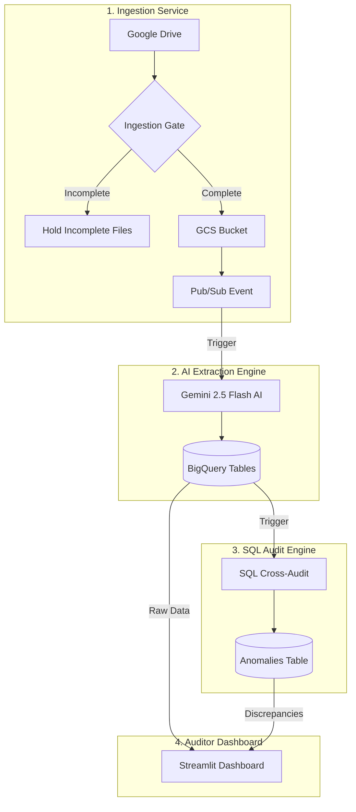

# Autonomous Cross-Document Logistics Audit Platform
## Modular Component Architecture & Technical Documentation

---

## 1. System Architecture Overview

---

## Component 1: Document Ingestion Service

### Purpose & Scope
The **Document Ingestion Service** runs as a scheduled Cloud Run container job. It monitors incoming shipment folders in Google Drive, enforces mandatory **Ingestion Gate** completeness validation, streams verified PDFs to Google Cloud Storage (GCS), and dispatches Pub/Sub triggers to wake up the downstream AI extraction engine.

### Component Files
- [`ingestion/main.py`](file:///c:/Users/313581/logistics-audit-ui/ingestion/main.py)
- [`ingestion/Dockerfile`](file:///c:/Users/313581/logistics-audit-ui/ingestion/Dockerfile)
- [`ingestion/requirements.txt`](file:///c:/Users/313581/logistics-audit-ui/ingestion/requirements.txt)

---

### Detailed Implementation Logic & Algorithms

1. **Google Drive OAuth Authorization & Directory Scanning**:
   - Uses `google.auth.default(scopes=['https://www.googleapis.com/auth/drive'])` to request Application Default Credentials in GCP Cloud Run.
   - Builds the Google Drive v3 API client (`drive_service`) and queries target input folders for non-trashed PDF files (`mimeType='application/pdf'`).

2. **Regex Grouping & The Ingestion Gate**:
   - Scans incoming filenames using regular expression `re.search(r'_(\d{8})', file_name)` to extract 8-digit shipment IDs (e.g., `CIV_10351463.pdf` -> `10351463`).
   - Groups files into a dictionary structure `shipments[shipment_id] = [file1, file2, ...]`.
   - **Ingestion Gate Check**: Scans grouped filenames to verify presence of all mandatory documents:
     - `has_civ`: Commercial Invoice
     - `has_pkl`: Packing List
     - `has_sli`: Shipper's Letter of Instructions
   - **Gate Decision**:
     - *Gate Fail*: If any mandatory document is missing, the gate logs `[Shipment ID] Shipment incomplete. Waiting for remaining documents` and leaves all PDFs untouched in Google Drive until missing files are uploaded.
     - *Gate Pass*: When all mandatory documents are present, the shipment is unleashed for full processing.

3. **In-Memory Streaming & Stale Buffer Cleaning**:
   - Calls `clear_gcs_folder()` to delete any existing blobs under `shipment_{shipment_id}/` in GCS bucket `logistic-audit-pdfs`. This prevents stale PDF contamination on re-uploads.
   - Downloads PDF media chunks from Drive using `MediaIoBaseDownload` into an in-memory `io.BytesIO()` buffer and uploads directly to GCS via `blob.upload_from_file()`. Files are transferred without writing to local container disk storage.

4. **Drive State Transfer & Event Triggering**:
   - Moves processed files out of the Input folder into the Processed Drive folder using `drive_service.files().update(addParents=..., removeParents=...)`.
   - Generates a single ISO batch timestamp (`processed_at`) in Chicago time (`ZoneInfo("America/Chicago")`).
   - Formats a JSON payload containing `shipment_id`, `processed_at`, and GCS URIs, publishing it to GCP Pub/Sub topic `shipment-processing-trigger`. Synchronous delivery confirmation is enforced via `future.result()`.

---

### Ingestion Line-Level Feature Map

| Feature / Logic | Implementation Location | Line Numbers | Description |
| :--- | :--- | :--- | :--- |
| **Drive OAuth Credentials & Scopes** | [`ingestion/main.py`](file:///c:/Users/313581/logistics-audit-ui/ingestion/main.py#L10-L16) | Lines 10–16 | Initializes default Google credentials with `drive` scope and builds the v3 Drive service. |
| **Pub/Sub Publisher Client** | [`ingestion/main.py`](file:///c:/Users/313581/logistics-audit-ui/ingestion/main.py#L17-L22) | Lines 17–22 | Configures GCP Pub/Sub publisher for topic `shipment-processing-trigger`. |
| **Drive to GCS File Streaming** | [`ingestion/main.py`](file:///c:/Users/313581/logistics-audit-ui/ingestion/main.py#L23-L48) | Lines 23–48 | `transfer_drive_to_gcs()` downloads PDF media chunks into an in-memory buffer and uploads to GCS. |
| **Google Drive Directory Discovery** | [`ingestion/main.py`](file:///c:/Users/313581/logistics-audit-ui/ingestion/main.py#L50-L54) | Lines 50–54 | `get_files_in_folder()` executes `files().list` query for non-trashed PDFs in the target parent folder. |
| **Drive File Move Logic** | [`ingestion/main.py`](file:///c:/Users/313581/logistics-audit-ui/ingestion/main.py#L56-L68) | Lines 56–68 | `move_file_in_drive()` updates file parents in Drive, transferring files from Input to Processed folder. |
| **GCS Stale Folder Cleanup** | [`ingestion/main.py`](file:///c:/Users/313581/logistics-audit-ui/ingestion/main.py#L69-L82) | Lines 69–82 | `clear_gcs_folder()` deletes existing GCS blobs for `shipment_{shipment_id}/` prior to re-upload. |
| **Regex Shipment ID Matching** | [`ingestion/main.py`](file:///c:/Users/313581/logistics-audit-ui/ingestion/main.py#L103-L112) | Lines 103–112 | Scans Drive filenames using `_(\d{8})` regex pattern to parse 8-digit shipment IDs and group files. |
| **THE INGESTION GATE** | [`ingestion/main.py`](file:///c:/Users/313581/logistics-audit-ui/ingestion/main.py#L114-L124) | Lines 114–124 | Checks presence of mandatory documents (`CIV`, `PKL`, `SLI`). Blocks incomplete shipments from proceeding. |
| **Unified Batch Timestamp Generation** | [`ingestion/main.py`](file:///c:/Users/313581/logistics-audit-ui/ingestion/main.py#L126) | Line 126 | Generates Chicago timezone ISO timestamp injected across all documents in the batch. |
| **Pub/Sub Extraction Trigger Dispatch** | [`ingestion/main.py`](file:///c:/Users/313581/logistics-audit-ui/ingestion/main.py#L150-L160) | Lines 150–160 | Encodes shipment metadata and GCS URIs into JSON and publishes to Pub/Sub with synchronous confirmation (`future.result()`). |
| **Ingestion Container Definition** | [`ingestion/Dockerfile`](file:///c:/Users/313581/logistics-audit-ui/ingestion/Dockerfile#L1-L15) | Lines 1–15 | Container spec using `python:3.10-slim`, installing dependencies, and running `python main.py`. |
| **Ingestion Dependencies** | [`ingestion/requirements.txt`](file:///c:/Users/313581/logistics-audit-ui/requirements.txt#L1-L7) | Lines 1–7 | Requirements for Drive API client, GCS, Pub/Sub, and Google Auth. |

---

## Component 2: AI Extraction & Extracted Indicators Engine

### Purpose & Scope
The **AI Extraction & Extracted Indicators Engine** is an asynchronous GCP Cloud Function woke up by Pub/Sub event payloads. It executes concurrent multi-document data extraction using Gemini 2.5 Flash with structured JSON schemas and loads raw structured fields and indicators into BigQuery tables.

### Component Files
- [`extractions/main.py`](file:///c:/Users/313581/logistics-audit-ui/extractions/main.py)
- [`extractions/requirements.txt`](file:///c:/Users/313581/logistics-audit-ui/extractions/requirements.txt)

---

### Extracted Indicators & Field Specifications by Document Type

| Document Type | Primary Extracted Fields & Indicators | Structural Type | Description & Indicators Captured |
| :--- | :--- | :--- | :--- |
| **CIV** (Commercial Invoice) | `currency` `total_amount` `items.material_number` `items.hts_code` `items.unit_price` `items.total_value` | Object with Array | Captures normalized 3-letter currency code (e.g. `USD`, `EUR`), grand invoice total amount, and itemized array of materials, Harmonized Tariff Schedule (HTS) codes, unit prices, and line totals. |
| **PKL** (Packing List) | `gross_weight_lb` `gross_weight_kg` `net_weight_lb` `net_weight_kg` `pallet_count` `loose_case_count` `material_numbers` | Primitive Numbers & String Array | Captures baseline gross/net weights in both LB and KG, total pallet counts, loose case counts, and array of material numbers. **Designated as the single source of truth for weight baseline.** |
| **SLI** (Shipper's Letter of Instructions) | `currency` `total_value_usd` `gross_weight_kg` `net_weight_kg` `items.value_usd` `items.gross_weight_kg` `items.net_weight_kg` | Object with Array | Captures currency, grand total value in USD, gross and net weights in KG, and itemized breakdown array of line values and weights. |
| **VGM** (Verified Gross Mass) | `gross_weight_lb` `gross_weight_kg` | Primitive Numbers | Captures container gross weight verification in pounds (LB) and kilograms (KG). |

---

### Detailed Implementation Logic & Algorithms

1. **Async Concurrent Fan-Out Extraction via Gemini 2.5 Flash**:
   - Triggered asynchronously by Pub/Sub Cloud Events (`pubsub_trigger`).
   - Defines strict Pydantic-compatible JSON schemas (`civ_schema`, `pkl_schema`, `sli_schema`, `vgm_schema`) enforcing primitive types (`NUMBER`, `STRING`, `ARRAY`, `OBJECT`).
   - Specialized Prompt Engineering handles document edge-cases:
     - **CIV**: Sums total amounts across multi-page invoice bundles into a single grand total `total_amount`; normalizes currencies to 3-letter ISO standards (e.g. `USD`).
     - **PKL**: Extracts gross and net weights in both LB and KG; parses total pallets and loose cases; collects material number arrays.
     - **SLI**: Sums itemized line values, gross/net KG weights, and document grand total values.
     - **VGM**: Extracts container gross weight in LB and KG.
   - Calls `client.aio.models.generate_content` concurrently across all shipment files via `asyncio.gather()`, achieving low-latency parallel processing.

2. **BigQuery Rate-Limit Backoff Loading**:
   - Inserts extracted JSON payloads into BigQuery (`CIV_Tbl`, `PKL_Tbl`, `SLI_Tbl`, `VGM_Tbl`) using `bq_client.load_table_from_json()`.
   - Employs a 5-attempt retry loop with backoff (`(attempt + 1) * 3` seconds) to handle BigQuery API rate limit exceptions (`403` / `rateLimitExceeded`).

---

### Extraction & Indicators Line-Level Feature Map

| Feature / Logic | Implementation Location | Line Numbers | Description |
| :--- | :--- | :--- | :--- |
| **GCP BigQuery & Storage Initialization** | [`extractions/main.py`](file:///c:/Users/313581/logistics-audit-ui/extractions/main.py#L15-L40) | Lines 15–40 | Configures `bigquery.Client` and `genai.Client` for Gemini model `gemini-2.5-flash`. |
| **Structured JSON Extraction Schemas** | [`extractions/main.py`](file:///c:/Users/313581/logistics-audit-ui/extractions/main.py#L42-L88) | Lines 42–88 | Defines Pydantic/JSON schemas for `civ_schema`, `pkl_schema`, `sli_schema`, and `vgm_schema`. |
| **Async Gemini Extraction with Retry** | [`extractions/main.py`](file:///c:/Users/313581/logistics-audit-ui/extractions/main.py#L90-L125) | Lines 90–125 | `extract_from_document()` invokes Gemini `generate_content` asynchronously with JSON schema enforcement and 5-attempt retry. |
| **Document Prompts & Concurrent Orchestration** | [`extractions/main.py`](file:///c:/Users/313581/logistics-audit-ui/extractions/main.py#L127-L198) | Lines 127–198 | `process_shipment_concurrently()` defines specialized prompts and fans out extraction requests via `asyncio.gather`. |
| **BigQuery Load Jobs with Backoff** | [`extractions/main.py`](file:///c:/Users/313581/logistics-audit-ui/extractions/main.py#L200-L232) | Lines 200–232 | Inserts extracted JSON into BigQuery (`CIV_Tbl`, `PKL_Tbl`, `SLI_Tbl`, `VGM_Tbl`) with exponential backoff on rate limits. |
| **GCP Cloud Event Pub/Sub Handler** | [`extractions/main.py`](file:///c:/Users/313581/logistics-audit-ui/extractions/main.py#L377-L402) | Lines 377–402 | `pubsub_trigger()` decodes base64 Pub/Sub payload and triggers `asyncio.run(process_shipment_concurrently)`. |

---

## Component 3: SQL Cross-Document Audit & Discrepancy Engine

### Purpose & Scope
The **SQL Cross-Document Audit & Discrepancy Engine** automatically executes relational SQL cross-validation queries in Google BigQuery immediately after raw extraction loads complete. It compares values across `CIV_Tbl`, `PKL_Tbl`, `SLI_Tbl`, and `VGM_Tbl`, inserting discrepancy records into `Shipment_Anomalies_Tbl`.

### Component Files
- [`extractions/main.py`](file:///c:/Users/313581/logistics-audit-ui/extractions/main.py) (Lines 236–358)

---

### Discrepancy Categories & Audit Logic

| Discrepancy Category | Documents Compared | Audit Rule & Logic | Tolerance Threshold |
| :--- | :--- | :--- | :--- |
| **Financial Total Mismatch** | CIV (`total_amount`) vs SLI (`total_value_usd`) | Aggregates grand totals across all commercial invoice documents and compares against SLI total USD value. Currency codes are checked; foreign currency transactions (e.g. `EUR`, `CAD`) automatically bypass comparisons to avoid false positive exchange flags. | Flags anomaly if `ABS(CIV_Total - SLI_Total) > $1.00 USD`. |
| **Gross Weight Mismatch** | PKL vs VGM (LB) PKL vs SLI (KG) | Compares container gross weight from VGM against Packing List (PKL) baseline. Compares SLI gross weight in KG against PKL gross weight in KG. **PKL is designated as the single source of truth (`expected_value`).** | Flags anomaly if VGM != PKL (LB) or `ABS(PKL - SLI) > 1.0 KG`. |
| **Net Weight Mismatch** | PKL vs SLI (KG) | Unnests net weight in KG from SLI line items/totals and compares against Packing List (PKL) net weight in KG as `expected_value`. | Flags anomaly if `ABS(PKL_Net - SLI_Net) > 1.0 KG`. |
| **Missing Material Number in CIV** | PKL (`material_numbers`) vs CIV (`items.material_number`) | Executes `LEFT JOIN` between all unnested material numbers from the Packing List and Commercial Invoice item material numbers. | Flags anomaly if a material number on PKL is missing from CIV. |

---

### Audit Engine Line-Level Feature Map

| Feature / Logic | Implementation Location | Line Numbers | Description |
| :--- | :--- | :--- | :--- |
| **Cross-Document SQL Audit Engine** | [`extractions/main.py`](file:///c:/Users/313581/logistics-audit-ui/extractions/main.py#L236-L358) | Lines 236–358 | `audit_query` executes DML `INSERT INTO Shipment_Anomalies_Tbl` evaluating rank-partitioned latest document uploads (`QUALIFY RANK() OVER(...) = 1`). |
| **Financial Reconciliation (CIV vs SLI)** | [`extractions/main.py`](file:///c:/Users/313581/logistics-audit-ui/extractions/main.py#L286-L298) | Lines 286–298 | Compares aggregated CIV total amounts against SLI total USD value ($1.00 tolerance, foreign currency bypass). |
| **Weight Audit: PKL vs VGM (LB)** | [`extractions/main.py`](file:///c:/Users/313581/logistics-audit-ui/extractions/main.py#L301-L313) | Lines 301–313 | Compares VGM Gross Weight against PKL Gross Weight. **PKL is set as `expected_value` (Source of Truth)**. |
| **Weight Audit: PKL vs SLI (KG, 1 KG Tolerance)** | [`extractions/main.py`](file:///c:/Users/313581/logistics-audit-ui/extractions/main.py#L316-L341) | Lines 316–341 | Unnests gross and net KG weights comparing SLI against PKL as `expected_value` with 1.0 KG tolerance. |
| **Material Compliance Audit (PKL vs CIV)** | [`extractions/main.py`](file:///c:/Users/313581/logistics-audit-ui/extractions/main.py#L345-L358) | Lines 345–358 | Performs `LEFT JOIN` between PKL material numbers and CIV item material numbers to flag missing items. |

---

## Component 4: Master Audit Queue Dashboard & UI Filters

### Purpose & Scope
The **Master Audit Queue Dashboard** is a Streamlit application deployed on Cloud Run. It provides logistics managers with executive KPI metrics, interactive multi-attribute queue filtering, visual shipment indicator badges, discrepancy category filters, and live side-by-side PDF document inspection.

### Component Files
- [`app.py`](file:///c:/Users/313581/logistics-audit-ui/app.py)
- [`Dockerfile`](file:///c:/Users/313581/logistics-audit-ui/Dockerfile)
- [`Procfile`](file:///c:/Users/313581/logistics-audit-ui/Procfile)
- [`requirements.txt`](file:///c:/Users/313581/logistics-audit-ui/requirements.txt)
- [`.streamlit/config.toml`](file:///c:/Users/313581/logistics-audit-ui/.streamlit/config.toml)

---

### Dashboard UI Features, Indicators & Category Filters

#### 1. Visual Shipment Indicators (`get_shipment_indicators()`, [`app.py:280–354`](file:///c:/Users/313581/logistics-audit-ui/app.py#L280-L354))
The dashboard calculates and displays visual indicator badges for each shipment in the Master Audit Queue:
- **Currency Indicator (`💱 <CURRENCY>`)**: Displays non-standard or foreign transaction currency codes extracted from Commercial Invoices or SLIs (e.g., `💱 EUR`, `💱 CAD`, `💱 MXN`, `💱 USD`).
- **Zero-Dollar ($0) Item Indicator (`🏷️ N ($0 items)`)**: Highlights line items where unit price or total item value was extracted as `$0.00`. Grouped and categorized by Harmonized Tariff Schedule (HTS) codes and material numbers.
- **HTS Code Breakdown**: Aggregates Harmonized Tariff Schedule (HTS) code classifications and associated material numbers extracted across line items.

#### 2. Discrepancy Categories Filters ([`app.py:733–738`](file:///c:/Users/313581/logistics-audit-ui/app.py#L733-L738))
The Master Audit Queue filter bar allows users to filter shipments by **Discrepancy Category**:
- **Financial**: Filters shipments with total dollar amount discrepancies between CIV and SLI.
- **Weight**: Filters shipments with gross or net weight mismatches across PKL, VGM, and SLI.
- **Material Compliance**: Filters shipments with material numbers listed on PKL that are missing from CIV.
- **None / Passed**: Filters shipments that passed all automated cross-document audits cleanly with zero discrepancies.

#### 3. Status Filters & Search Bar ([`app.py:728–732`](file:///c:/Users/313581/logistics-audit-ui/app.py#L728-L732))
- **Status Filter**: Multiselect filter allowing users to view `Passed` (zero audit anomalies) or `Failed` (one or more flagged discrepancies) shipments.
- **Shipment ID Search**: Instant text search input to locate specific 8-digit shipment packages.

#### 4. Live Side-by-Side PDF Viewer ([`app.py:181–380`, `831–880`](file:///c:/Users/313581/logistics-audit-ui/app.py#L831-L880))
- Downloads PDF bytes directly from GCS (`logistic-audit-pdfs`) using `download_pdf_bytes_cached()`.
- Renders PDF pages into high-resolution PNG images via PyMuPDF (`fitz`) side-by-side with extracted document tables.

---

### Dashboard Line-Level Feature Map (`app.py`)

| Dashboard Feature | Implementation Location | Line Numbers | Detailed Description |
| :--- | :--- | :--- | :--- |
| **BigQuery & Storage Caching Setup** | [`app.py`](file:///c:/Users/313581/logistics-audit-ui/app.py#L19-L48) | Lines 19–48 | `@st.cache_resource` and `@st.cache_data` handlers initializing BigQuery, GCS, and cached PDF bytes download. |
| **BigQuery Anomaly & Indicator Queries** | [`app.py`](file:///c:/Users/313581/logistics-audit-ui/app.py#L49-L180) | Lines 49–180 | Queries latest document sync timestamps, raw document tables (`CIV_Tbl`, `PKL_Tbl`, etc.), and `Shipment_Anomalies_Tbl`. |
| **PyMuPDF PDF Rendering Engine** | [`app.py`](file:///c:/Users/313581/logistics-audit-ui/app.py#L181-L279) | Lines 181–279 | Renders PDF pages using PyMuPDF (`fitz`) and converts pages to PNG image strings for Streamlit display. |
| **Extracted Indicators Calculation Engine** | [`app.py`](file:///c:/Users/313581/logistics-audit-ui/app.py#L280-L354) | Lines 280–354 | `get_shipment_indicators()` queries `$0` line items, currency codes, and HTS groups to construct indicator string badges (`💱 EUR`, `🏷️ 2 ($0 items)`). |
| **Executive KPI Summary Metrics** | [`app.py`](file:///c:/Users/313581/logistics-audit-ui/app.py#L580-L620) | Lines 580–620 | Renders metric cards showing Total Shipments, Passed Shipments, Flagged Anomalies, and Processing Queues. |
| **Search, Status & Category Filters Bar** | [`app.py`](file:///c:/Users/313581/logistics-audit-ui/app.py#L621-L750) | Lines 621–750 | Multiselect filters for Status (`Passed`, `Failed`), **Categories (`Financial`, `Weight`, `Material Compliance`, `None`)**, and text search by Shipment ID. |
| **Extracted Data Inspection Tables** | [`app.py`](file:///c:/Users/313581/logistics-audit-ui/app.py#L751-L830) | Lines 751–830 | Displays tabbed extracted data tables for CIV, PKL, SLI, and VGM documents. |
| **Live Side-by-Side PDF Viewer** | [`app.py`](file:///c:/Users/313581/logistics-audit-ui/app.py#L831-L880) | Lines 831–880 | Embeds live PDF page navigation controls side-by-side with extracted document data. |
| **Anomaly Summary Table & CSV Export** | [`app.py`](file:///c:/Users/313581/logistics-audit-ui/app.py#L881-L902) | Lines 881–902 | Renders flagged anomaly summary table with category badges and CSV export options. |
| **UI Container Deployment Spec** | [`Dockerfile`](file:///c:/Users/313581/logistics-audit-ui/Dockerfile#L1-L19) | Lines 1–19 | Base image `python:3.11-slim`, exposes port `8501`, runs Streamlit headless server. |

---

## Component 5: Historical Reprocessing & Maintenance Utilities

### Purpose & Scope
The **Historical Reprocessing Utility** allows administrators to re-run extraction and auditing against historical GCS shipments without losing original batch timestamps or duplicating database records.

### Component Files
- [`reprocess_past_shipments.py`](file:///c:/Users/313581/logistics-audit-ui/reprocess_past_shipments.py)

---

### Detailed Implementation Logic & Maintenance Workflows

1. **Historical Timestamp Preservation**:
   - Queries `MAX(processed_at)` across BigQuery tables (`CIV_Tbl`, `PKL_Tbl`, `SLI_Tbl`, `VGM_Tbl`) for every shipment ID.
   - Preserves original processing timestamps instead of generating new execution timestamps. This maintains historical batch audit trails.

2. **GCS Bucket Folder Discovery & Selective Truncation**:
   - Scans `gs://logistic-audit-pdfs/` to map existing shipment folder structure and file URIs.
   - Safely executes `TRUNCATE TABLE` queries across all 5 BigQuery dataset tables (`CIV_Tbl`, `PKL_Tbl`, `SLI_Tbl`, `VGM_Tbl`, `Shipment_Anomalies_Tbl`) to purge previous extractions.

3. **Staggered Pub/Sub REST Event Dispatching**:
   - Constructs Pub/Sub JSON triggers containing preserved timestamps and file URIs.
   - Publishes payloads to GCP Pub/Sub REST API using OAuth Bearer tokens.
   - Introduces a `time.sleep(2.5)` delay between published shipments to stagger downstream Cloud Function execution and prevent Gemini API rate limit exhaustion.

---

### Reprocessing Line-Level Feature Map

| Feature / Logic | Implementation Location | Line Numbers | Description |
| :--- | :--- | :--- | :--- |
| **Pub/Sub REST API Publisher** | [`reprocess_past_shipments.py`](file:///c:/Users/313581/logistics-audit-ui/reprocess_past_shipments.py#L22-L41) | Lines 22–41 | `publish_pubsub_payload()` formats base64 message payloads and publishes to Pub/Sub via REST API. |
| **Historical Timestamp Preservation** | [`reprocess_past_shipments.py`](file:///c:/Users/313581/logistics-audit-ui/reprocess_past_shipments.py#L51-L70) | Lines 51–70 | Queries BigQuery `MAX(processed_at)` across document tables to retain original ingestion dates. |
| **GCS Bucket Folder Grouping** | [`reprocess_past_shipments.py`](file:///c:/Users/313581/logistics-audit-ui/reprocess_past_shipments.py#L71-L100) | Lines 71–100 | Discovers all `shipment_*` folders in `logistic-audit-pdfs` GCS bucket and maps PDF URIs. |
| **BigQuery Table Truncation** | [`reprocess_past_shipments.py`](file:///c:/Users/313581/logistics-audit-ui/reprocess_past_shipments.py#L101-L111) | Lines 101–111 | Executes `TRUNCATE TABLE` on `CIV_Tbl`, `PKL_Tbl`, `SLI_Tbl`, `VGM_Tbl`, and `Shipment_Anomalies_Tbl`. |
| **Staggered Event Re-Triggering** | [`reprocess_past_shipments.py`](file:///c:/Users/313581/logistics-audit-ui/reprocess_past_shipments.py#L112-L130) | Lines 112–130 | Loops through all historical shipments and dispatches Pub/Sub triggers with 2.5s delay to prevent API rate limits. |

---

## Component 6: Configuration & Repository Governance

| File Path | Config Role | Lines | Key Settings & Directives |
| :--- | :--- | :--- | :--- |
| [`.gitignore`](file:///c:/Users/313581/logistics-audit-ui/.gitignore) | Git Exclusion | Lines 1–36 | Ignores `__pycache__/`, `.venv/`, node modules, Streamlit local cache, GCP credential JSONs, and scratch PDFs. |
| [`.streamlit/config.toml`](file:///c:/Users/313581/logistics-audit-ui/.streamlit/config.toml) | UI Server Config | Lines 1–6 | Configures `headless = true`, `enableCORS = false`, `address = "0.0.0.0"`, `port = 8501`. |
